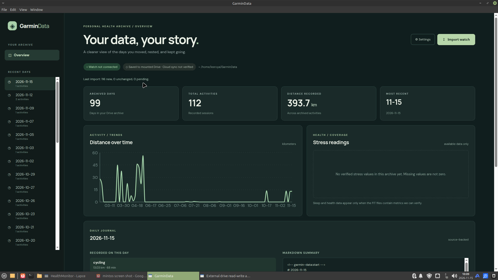

# HealthMonitor — an app to own your health data

I've started building a health app, and it's intentionally simple in its first couple of rounds. The point isn't to ship a finished product — it's to understand the moving parts and learn how to craft this kind of application.

The project lives on GitHub: [Ashworx-Global/HealthMonitor](https://github.com/Ashworx-Global/HealthMonitor).

## The idea

Health apps usually own your data. You hand over your heart rate, your sleep, your workouts, and you get a dashboard in return — hosted on someone else's servers, under someone else's terms.

HealthMonitor flips that around:

- **Free to download.** No subscription to unlock what you already recorded.
- **Use what you already have.** Health metrics are produced using AI models and subscriptions you're already paying for — no new vendor lock-in.
- **Built-in agents for Garmin stats.** Pull in your Garmin data and let agents help make sense of it.
- **Own your data.** Back everything up to your own Google Drive. Your data, your account, your control.
- **Overlay health reports.** Drop in health reports and have the data overlaid so trends are visible in one place.
- **Sleep scores and overall health.** Track sleep quality and overall health indicators over time.

## Why build it this way

The first rounds are deliberately about learning. Before adding polish, I want to understand the moving parts: how the data flows from Garmin into the app, how AI models can turn raw metrics into useful insight, how to keep a backup portable and under the user's control, and how sleep scores combine with other signals into an overall health picture.

That means features and fixes are still coming. These early iterations are about getting the foundation right rather than racing to a finished app.

## Own your data, own your health

The thread running through all of this is ownership. Your health data is some of the most personal information you have. It should live where you can reach it, back it up yourself, and take it with you — not be held hostage behind a paywall or a closed API.

If you want to follow along, watch the repo: [github.com/Ashworx-Global/HealthMonitor](https://github.com/Ashworx-Global/HealthMonitor).
